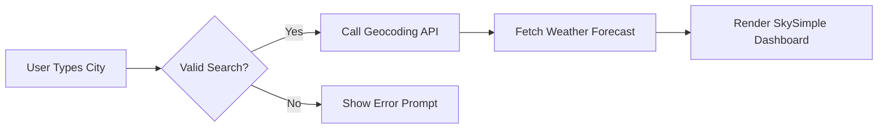

# The Ultimate Markdown Guide & Reference Manual 📝

A complete, beginner-to-advanced cheat sheet and reference guide for writing documents in **Markdown** and **GitHub Flavored Markdown (GFM)**.

---

## 📑 Table of Contents
1. [What is Markdown?](#what-is-markdown)
2. [Headings](#headings)
3. [Text Styling & Formatting](#text-styling--formatting)
4. [Lists](#lists)
5. [Links & Images](#links--images)
6. [Code & Syntax Highlighting](#code--syntax-highlighting)
7. [Blockquotes & Alerts](#blockquotes--alerts)
8. [Tables](#tables)
9. [Task Lists (Checklists)](#task-lists-checklists)
10. [Collapsible Sections](#collapsible-sections)
11. [Math & Equations (KaTeX/LaTeX)](#math--equations)
12. [Mermaid Diagrams](#mermaid-diagrams)
13. [Footnotes & Horizontal Rules](#footnotes--horizontal-rules)
14. [Badges & Shields](#badges--shields)
15. [Quick Reference Cheat Sheet](#quick-reference-cheat-sheet)

---

## 1. What is Markdown?
**Markdown** is a lightweight markup language created by John Gruber and Aaron Swartz in 2004. It allows you to format plain text easily, which can then be converted into HTML, PDF, or styled web pages. It is universally used on GitHub, Reddit, Notion, Obsidian, Discord, and documentation sites.

---

## 2. Headings

Use the `#` symbol followed by a space. The number of `#` determines the heading level (1 to 6).

### Markdown Syntax:
```markdown
# Heading Level 1 (H1 - Page Title)
## Heading Level 2 (H2 - Section)
### Heading Level 3 (H3 - Sub-section)
#### Heading Level 4 (H4)
##### Heading Level 5 (H5)
###### Heading Level 6 (H6)
```

> [!TIP]
> Always leave a space between the `#` and your heading text (e.g., `# Title`, not `#Title`).

---

## 3. Text Styling & Formatting

### Markdown Syntax:
```markdown
**Bold text** or __Bold text__
*Italicized text* or _Italicized text_
***Bold and italicized***
~~Strikethrough~~
`Inline code or keyword`
==Highlighted text== (supported in many modern markdown viewers)
H~2~O (Subscript - where supported)
X^2^ (Superscript - where supported)
```

### Rendered Output:
- **Bold text**
- *Italicized text*
- ***Bold and italicized***
- ~~Strikethrough~~
- `Inline code or keyword`

---

## 4. Lists

### Unordered (Bulleted) Lists
Use `-`, `*`, or `+`:
```markdown
- Item 1
- Item 2
  - Sub-item 2.1 (Indent by 2 or 4 spaces)
  - Sub-item 2.2
- Item 3
```

### Ordered (Numbered) Lists
```markdown
1. First step
2. Second step
3. Third step
   1. Sub-step A
   2. Sub-step B
```

---

## 5. Links & Images

### Links
```markdown
[Clickable Text](https://www.example.com)
[Link with Hover Title](https://www.example.com "Visit Example")
<https://www.example.com> (Automatic URL link)
```

### Images
Images use the exact same format as links, but prefixed with an exclamation mark `!`:
```markdown

```

### Linked Images (Clickable Image):
```markdown
[](https://www.example.com)
```

---

## 6. Code & Syntax Highlighting

### Inline Code
Wrap text in single backticks: `` `variableName` ``

### Code Blocks with Language Highlighting
Use triple backticks ```` ``` ```` followed by the language identifier (e.g., `javascript`, `python`, `html`, `css`, `bash`, `json`, `sql`, `markdown`):

````markdown
```javascript
function greet(name) {
  console.log(`Hello, ${name}!`);
}
greet('World');
```
````

````markdown
```python
def weather_forecast(city):
    return f"Checking weather for {city}..."

print(weather_forecast("San Francisco"))
```
````

````markdown
```bash
# Clone a repository
git clone https://github.com/user/repo.git
cd repo
npm install
```
````

---

## 7. Blockquotes & Alerts

### Standard Blockquote
```markdown
> "Simplicity is the soul of efficiency."
> — Austin Freeman
```

### Nested Blockquote
```markdown
> Level 1 Quote
>> Level 2 Nested Quote
```

### GitHub-Style Callout Alerts
GitHub Flavored Markdown supports beautiful alert callouts:

```markdown
> [!NOTE]
> Useful information that users should know, even when skimming content.

> [!TIP]
> Helpful advice for doing things better or more easily.

> [!IMPORTANT]
> Key information users need to know to achieve their goal.

> [!WARNING]
> Urgent info that needs immediate user attention to avoid problems.

> [!CAUTION]
> Advises about risks or negative outcomes of certain actions.
```

---

## 8. Tables

Create tables using pipes `|` and hyphens `-`. Align columns using colons `:`.

### Markdown Syntax:
```markdown
| Left-Aligned | Center-Aligned | Right-Aligned |
| :---         | :---:          | ---:          |
| Feature A    | Active         | $19.99        |
| Feature B    | Inactive       | $49.00        |
| Feature C    | Beta           | Free          |
```

### Rendered Output:
| Left-Aligned | Center-Aligned | Right-Aligned |
| :---         | :---:          | ---:          |
| Feature A    | Active         | $19.99        |
| Feature B    | Inactive       | $49.00        |
| Feature C    | Beta           | Free          |

---

## 9. Task Lists (Checklists)

Used for to-do items, issue tracking, and project checklists.

```markdown
- [x] Complete weather app layout
- [x] Integrate Open-Meteo & OpenWeatherMap APIs
- [ ] Add dark mode theme switch
- [ ] Deploy to web server
```

---

## 10. Collapsible Sections

Use standard HTML `<details>` and `<summary>` tags inside Markdown:

```markdown
<details>
  <summary><b>Click to expand secret tips 💡</b></summary>

  Here is the hidden content! You can put code, lists, or explanations inside.
  
  - Tip 1: Always test API responses.
  - Tip 2: Use caching to prevent rate-limits.
</details>
```

---

## 11. Math & Equations (KaTeX / LaTeX)

Supported in GitHub, GitLab, and Markdown renderers with KaTeX/MathJax:

### Inline Math:
`$E = mc^2$` or `\(a^2 + b^2 = c^2\)`

### Block / Display Math:
```markdown
$$
\frac{-b \pm \sqrt{b^2 - 4ac}}{2a}
$$
```

---

## 12. Mermaid Diagrams

Visualize workflows, flowcharts, architectures, and state machines directly in Markdown using `mermaid`:

````markdown

````

---

## 13. Footnotes & Horizontal Rules

### Horizontal Rule (Divider Line):
Use three or more asterisks `***`, dashes `---`, or underscores `___`:
```markdown
---
```

### Footnotes:
```markdown
Here is a statement that requires a reference.[^1]

[^1]: This is the footnote text shown at the bottom of the document.
```

---

## 14. Badges & Shields

Add repo badges using [Shields.io](https://shields.io):

```markdown


```

---

## 15. Quick Reference Cheat Sheet

| Element | Markdown Syntax |
| :--- | :--- |
| **Heading 1** | `# Heading 1` |
| **Heading 2** | `## Heading 2` |
| **Bold** | `**Bold text**` |
| **Italic** | `*Italic text*` |
| **Strikethrough** | `~~Deleted~~` |
| **Inline Code** | `` `code` `` |
| **Link** | `[Title](https://...)` |
| **Image** | `` |
| **Blockquote** | `> Quote text` |
| **Unordered List** | `- Item` or `* Item` |
| **Ordered List** | `1. Item` |
| **Task (Checked)** | `- [x] Done` |
| **Task (Unchecked)**| `- [ ] To-do` |
| **Horizontal Divider** | `---` |

---

*Authored for quick reference and documentation projects.*
